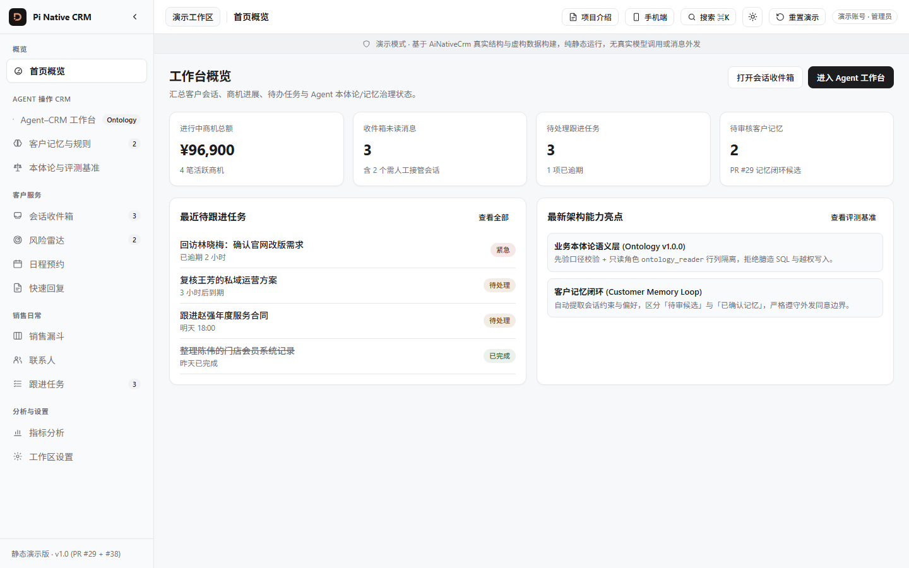
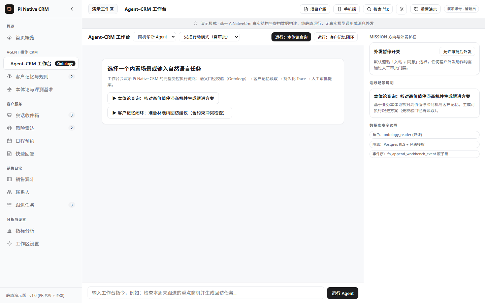
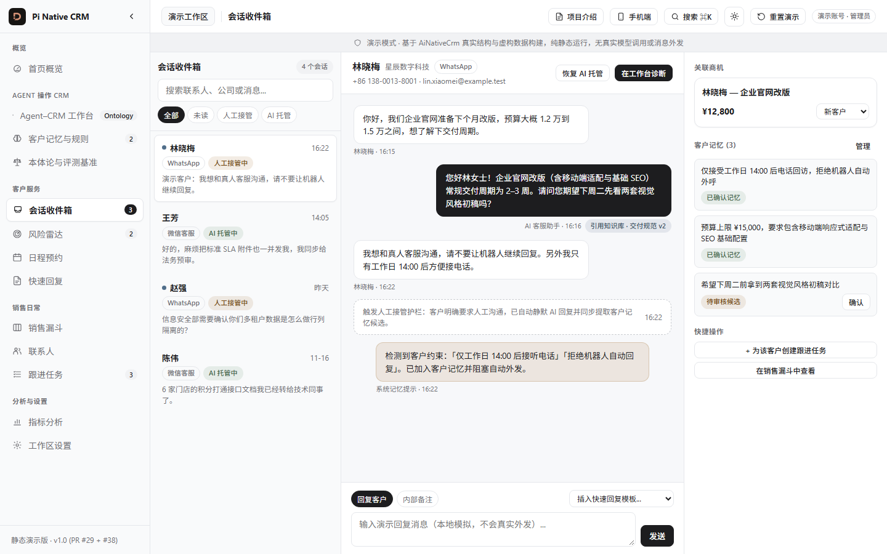
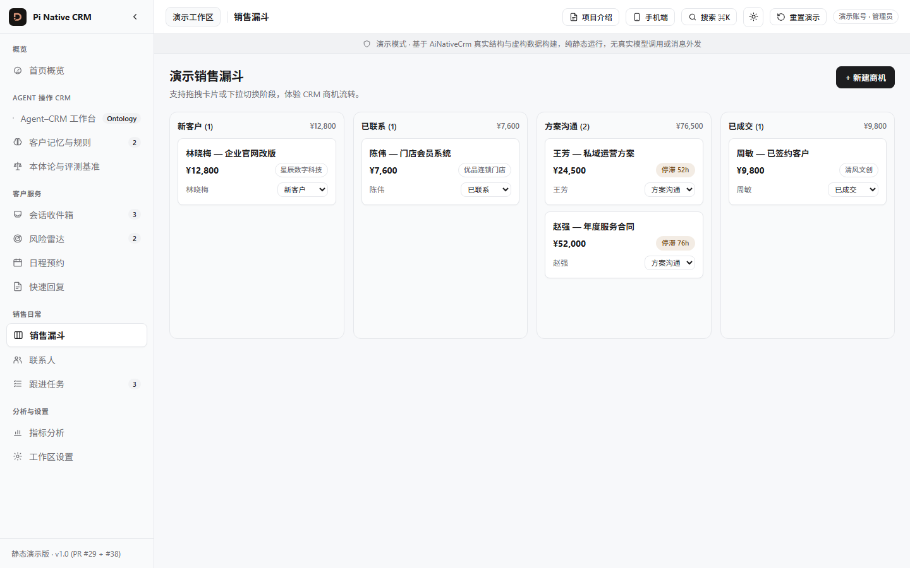

# AI Native CRM

<div align="center">

**面向 Agent 协作的多租户 CRM 工作台**

把客户、会话、商机、任务、知识与记忆组织成统一业务上下文，让 AI Agent 在权限、审批、预算和审计约束下参与真实 CRM 工作。

<a href="https://github.com/treasuresyq/AiNativeCrm">GitHub</a> ·
<a href="https://crm.helson.top/#/app">在线产品预览</a> ·
<a href="docs/architecture/README.md">系统架构</a> ·
<a href="docs/SETUP.md">开发配置</a> ·
<a href="docs/deploy-selfhost/README.md">自托管部署</a>


</div>

## 产品预览

以下截图来自项目的静态产品演示，展示 AI Native CRM 的真实信息架构与主要工作流。演示使用虚构数据，不会发起真实模型请求，也不会向外部渠道发送消息。

### 工作台概览



### Agent 工作台



### 会话收件箱



### 销售漏斗



## 项目定位

AI Native CRM 不是只展示页面的静态站点，而是一个由 Next.js、Supabase、Agent Runtime、后台 Worker 和外部协作服务共同组成的业务系统。

它关注四件事：

- Agent 能读取客户、会话、商机、知识和记忆形成业务上下文。
- Agent 只能通过受控工具推进 CRM，不能绕过权限直接修改数据库。
- 用户可以查看 Agent 做了什么、依据什么、调用了哪些工具，以及 CRM 发生了什么变化。
- 多 Agent 调查、人工确认、暂停恢复、预算控制和执行审计都成为可追踪的业务流程。

> CRM 保存业务事实，Agent Runtime 驱动行动，Harness 管理执行边界。

## 核心能力

### Agent CRM 工作台

- 以自然语言任务和 CRM 对象作为执行入口。
- 支持只读调查、受控写入、人工审批和外部动作确认。
- 查看上下文、决策、工具调用、Observation 和状态变化。
- 通过持久化 Run Events 与 SSE 续读，支持刷新后的执行回放。
- 展示模型绑定、Token 用量、工具次数、预算和终止原因。

### CRM 与多租户

- 客户、联系人、会话、商机、Pipeline、任务和跟进记录。
- 基于组织的多租户隔离，Supabase Postgres RLS 负责数据层访问控制。
- Supabase Auth、Storage 和 Realtime 集成。
- 角色权限、审计日志、幂等请求和 API 访问令牌。

### 客户记忆与业务本体

- 支持客户记忆候选的生成、确认、改写、驳回、锁定、复核和替换。
- 以业务本体描述客户、商机、任务、事件和 Agent 行动之间的关系。
- 通过知识库、记忆和历史 Run 为 Agent 提供可追溯依据。
- 使用确定性检查、语义评审和回归样例评估任务结果与策略遵守情况。

### 执行治理与 Harness

- 按读取、可逆写入、外部动作和不可逆动作管理工具。
- 贯穿组织作用域、权限、目标范围、策略和预算限制。
- 对需要确认的动作执行人工审批，并保存字段差异和审计记录。
- 支持暂停、恢复、取消、执行租约、重试和累计预算控制。
- 保存父子 Run，用于多 Agent 调查、结果汇总和后续业务动作。

### 会话与后台服务

- WhatsApp 通过 WAHA 接入会话和消息。
- 飞书支持企业内部协作、成员绑定、消息关联和任务续跑。
- Agent Worker 消费事件并执行后台 Agent 任务。
- Scheduler 运行定时任务和事件处理。
- Redis/Upstash 提供限流、队列辅助能力和幂等处理。

## 工作原理

```text
自然语言任务 + CRM 对象
          |
          v
上下文构建：CRM · Wiki · Memory · Skills · 历史 Run
          |
          v
Agent Loop <---------------- 工具结果 / 人工确认
          |                              ^
          v                              |
Harness：权限 · 范围 · 策略 · 预算 · 审批 · 恢复
          |                              |
          v                              |
CRM 工具端口 -------> 业务操作 -------> Observation
          |
          v
CRM 状态变化 + Run Events + Trace + Eval
```

数据库保存业务事实，Run、事件和检查点保存执行状态；知识和记忆提供依据；工具负责动作；评测负责反馈。

## 技术栈

| 领域 | 技术 |
| --- | --- |
| Web 应用 | Next.js 16 App Router、React 19、TypeScript |
| UI | Tailwind CSS 4、Radix UI、Lucide、Phosphor Icons |
| 数据库 | Supabase Postgres、RLS、Vector、Realtime、Storage |
| 认证 | Supabase Auth、`@supabase/ssr` |
| Agent | Pi Agent Core、Pi AI、Model Gateway |
| AI Provider | OpenAI、Anthropic、Google 及兼容模型接口 |
| 后台任务 | Agent Worker、Scheduler、`event_log` |
| 外部渠道 | WAHA、WhatsApp、飞书、WeKnora、Mem0、Langfuse |
| 测试 | Vitest、Playwright、axe-core |
| 生产运行 | Docker Compose、Caddy、Linux VPS |

## 快速开始

### 环境要求

- Node.js 22 或更高版本
- pnpm 9.15.9
- Supabase 项目
- Redis/Upstash 配置
- Git

```powershell
git clone https://github.com/treasuresyq/AiNativeCrm.git
Set-Location AiNativeCrm
corepack enable
corepack prepare pnpm@9.15.9 --activate
pnpm install --frozen-lockfile
Copy-Item .env.example .env.local
```

macOS/Linux：

```bash
git clone https://github.com/treasuresyq/AiNativeCrm.git
cd AiNativeCrm
corepack enable
corepack prepare pnpm@9.15.9 --activate
pnpm install --frozen-lockfile
cp .env.example .env.local
```

根据 [开发配置指南](docs/SETUP.md) 填写 Supabase、Redis、应用地址和服务端加密配置。不要把真实密钥写入 Git 仓库。

### 启动开发服务

```bash
pnpm dev --port 3000

# 另一个终端：Agent 执行进程
pnpm worker

# 另一个终端：本地调度任务
pnpm dev:crons
```

打开 `http://localhost:3000/app/ai/workbench`，登录后配置组织模型和 Agent，再选择 CRM 对象与任务开始运行。

### 常用命令

| 命令 | 用途 |
| --- | --- |
| `pnpm dev` | 启动开发 Web 服务 |
| `pnpm worker` | 启动 Agent Worker |
| `pnpm dev:crons` | 启动本地调度任务 |
| `pnpm ai:agents:ensure-builtins` | 为已有组织补齐内置 Agent |
| `pnpm typecheck` | TypeScript 类型检查 |
| `pnpm lint` | ESLint 检查 |
| `pnpm test:unit` | 单元测试 |
| `pnpm test:db` | 数据库隔离与不变量测试 |
| `pnpm test:e2e` | Playwright 浏览器测试 |
| `pnpm build` | 构建生产应用 |

## 部署模型

本项目的完整生产形态是 **Linux VPS + Docker Compose + Supabase**，不是纯静态网站。生产部署通常包含 app、worker、scheduler、WAHA、Redis 和 Caddy。

- [自托管部署](docs/deploy-selfhost/README.md)
- [生产部署运行手册](docs/runbooks/deploy.md)
- [部署检查清单](docs/DEPLOY-CHECKLIST.md)

GitHub、Cloudflare 和阿里云承担不同职责：

1. GitHub 保存代码、迁移文件、文档和部署配置，负责版本管理与回滚。
2. 阿里云 ECS 可以运行 Docker Compose、Next.js、Worker、Scheduler 和 WAHA 等长驻服务。
3. Cloudflare 可以承担 DNS、CDN、代理、SSL/TLS 或 Tunnel，但不替代 Node.js、数据库和后台 Worker。

如果只部署静态演示页，可以使用 Cloudflare Pages 或阿里云 OSS；完整 CRM 应优先按 VPS 自托管文档部署。

## 目录结构

```text
app/                    Next.js 页面、Server Actions 和 API Route Handlers
components/             UI 组件与业务组件
lib/                    CRM 领域逻辑、工具、Harness、知识和记忆适配器
workers/                Agent 后台执行进程
supabase/               数据库基线、迁移和 RLS
tests/                  单元、数据库、浏览器和专项验收测试
scripts/                开发、迁移、演示和部署辅助脚本
docs/                   架构、配置、部署和验证文档
```

## 文档导航

- [文档入口](docs/index.md)
- [开发配置](docs/SETUP.md)
- [系统架构](docs/architecture/README.md)
- [Agent 服务接入](docs/integrations/agent-services.md)
- [当前项目状态](docs/current-state.md)
- [自托管部署](docs/deploy-selfhost/README.md)
- [安全模型](docs/threat-model.md)

## 安全说明

- 不要提交 `.env`、`.env.local` 或任何真实凭据。
- `SUPABASE_SERVICE_ROLE_KEY`、模型 API Key、WAHA 密钥和加密密钥只能在服务端保存。
- 使用 Supabase Service Role 时，服务端必须显式校验组织作用域。
- 不要把真实客户数据、数据库备份、截图或运行日志提交到仓库。
- 漏洞请通过 [GitHub 私密安全报告](https://github.com/treasuresyq/AiNativeCrm/security/advisories/new) 提交。

## 当前状态

项目处于持续迭代阶段，仓库已包含 Agent 工作台、CRM 业务对象、受控工具执行、多租户数据隔离、后台 Worker、知识与记忆接入、评测和自托管部署相关实现。具体完成度与已知限制以 [当前项目状态](docs/current-state.md) 及 `docs/` 下的验证记录为准。

## License

本项目遵循仓库中的 [MIT License](LICENSE) 及相关原版权声明。
